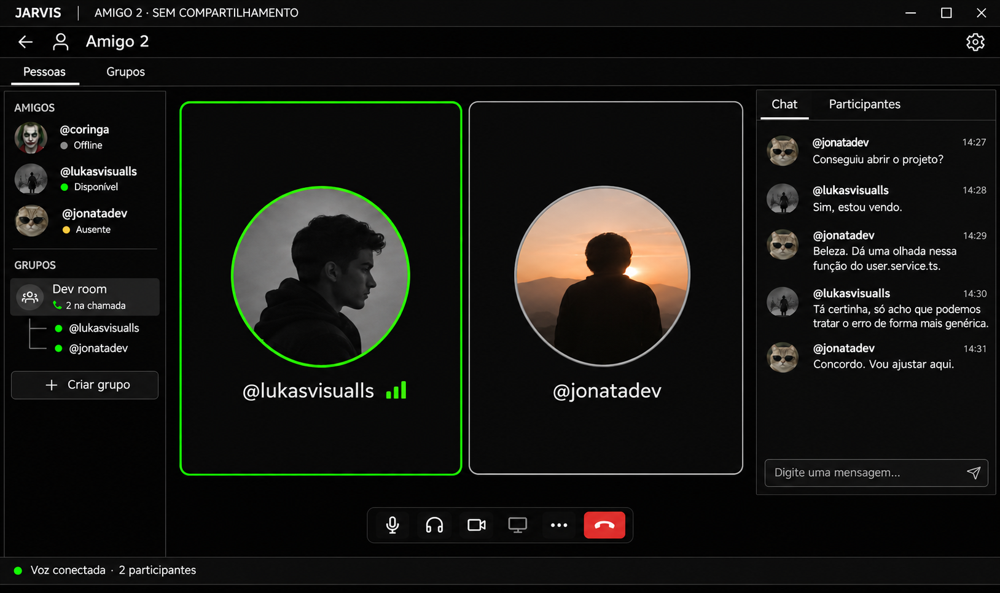

# Amigo 2 — JARVIS 2.1.268

[Baixar a nova versão](https://github.com/lucasvisualls9366-sudo/Jarvis-Releases/releases/tag/v2.1.268) · [Validação e checksums](VALIDACAO-AMIGO2-268.md)

Referências aprovadas pelo usuário. A barra adicional de título das imagens foi removida na implementação final, conforme solicitado. O código no editor é exemplo de conteúdo compartilhado; a aplicação transmite a tela real.

## Compartilhando tela

## Sem compartilhamento

