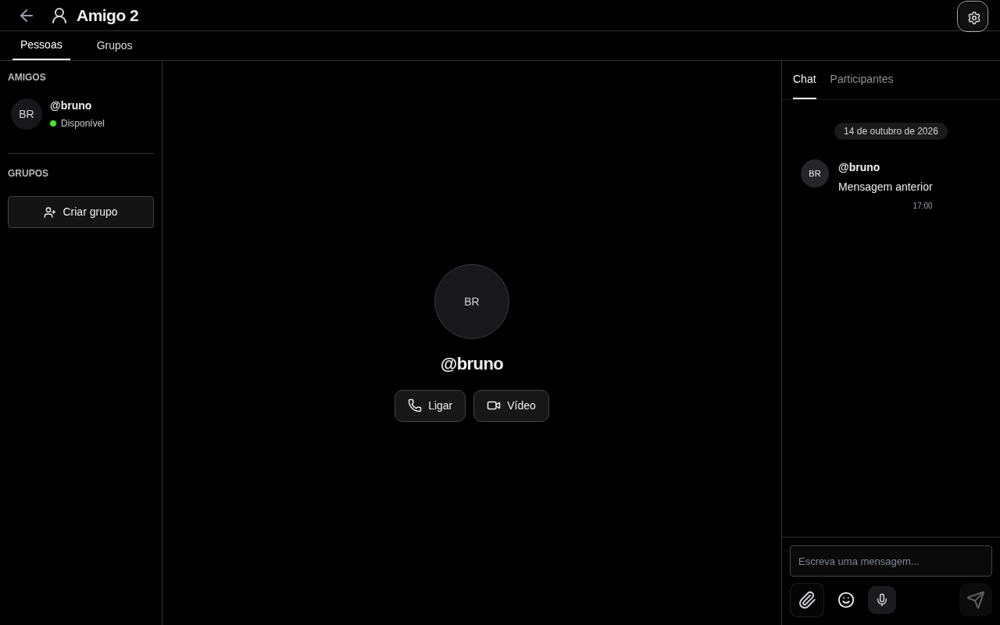
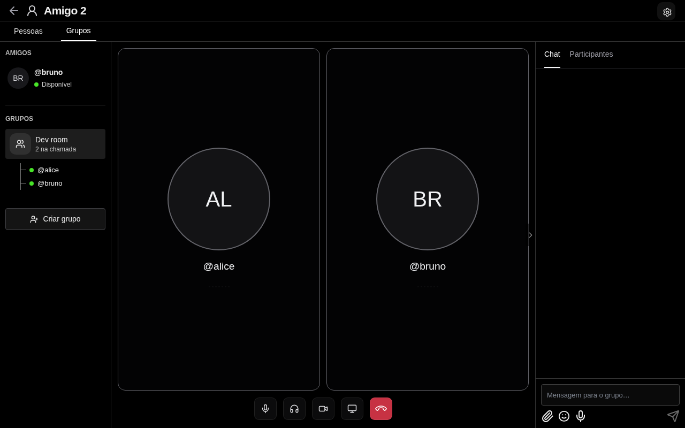
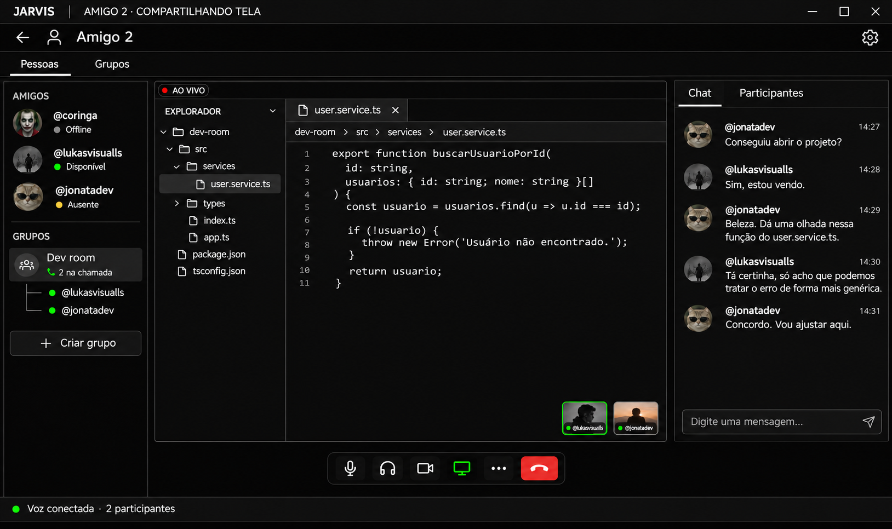

# Amigo 2 — JARVIS 2.1.269

[Baixar a nova versão](https://github.com/lucasvisualls9366-sudo/Jarvis-Releases/releases/tag/v2.1.269) · [Validação e checksums](VALIDACAO-AMIGO2-269.md)

A versão 2.1.269 restaura a moldura nativa do JARVIS com minimizar, maximizar/restaurar e fechar. O visual preto, as abas brancas e a estrutura da lateral também se aplicam fora de chamadas. Os participantes da chamada aparecem individualmente abaixo do grupo.

## Capturas reais com contas de teste

Capturas do conteúdo no navegador. Os controles —, □ e X pertencem à moldura nativa do aplicativo Windows e não aparecem nestas capturas.

### Fora da chamada

### Grupo e participantes na lateral

## Referências aprovadas

Fotos de perfil e mensagens variam conforme os dados reais. O editor ilustrado na referência é exemplo de conteúdo compartilhado; a aplicação transmite a tela real. A moldura nativa foi restaurada após a instrução posterior do usuário.

